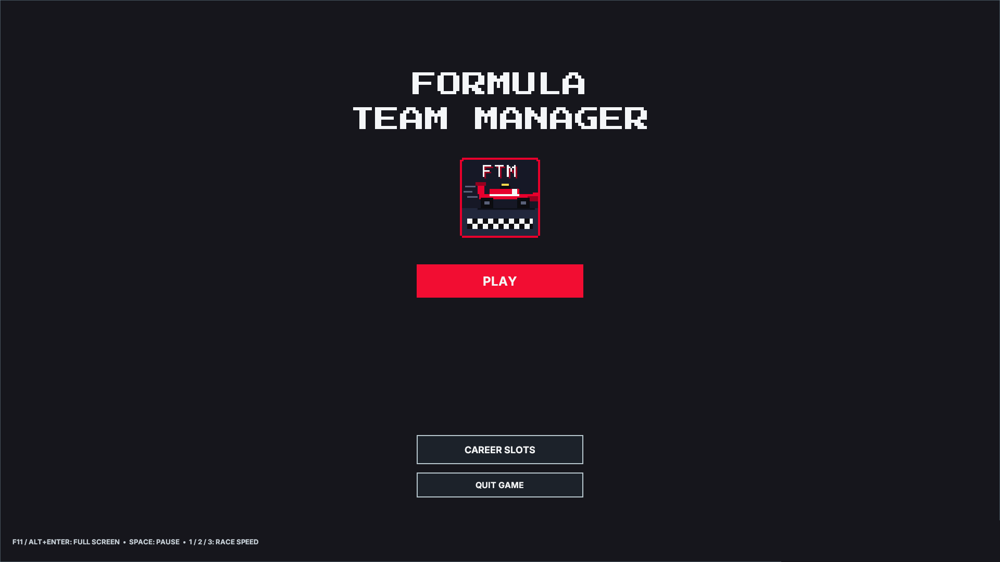
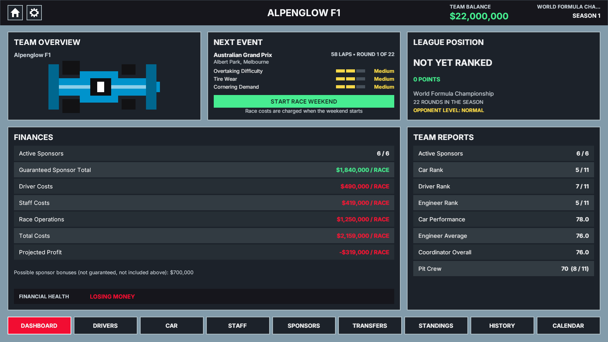
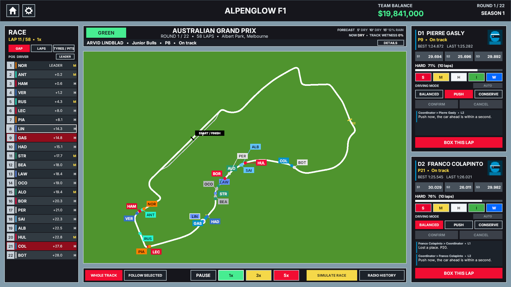
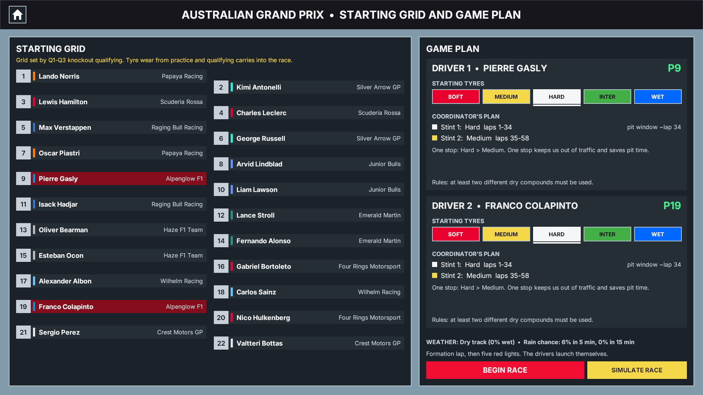
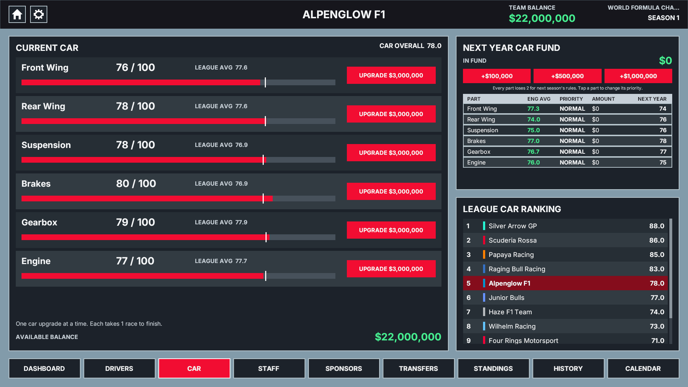
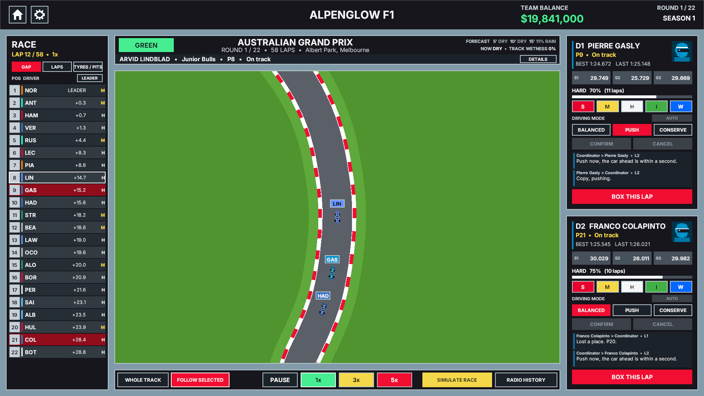
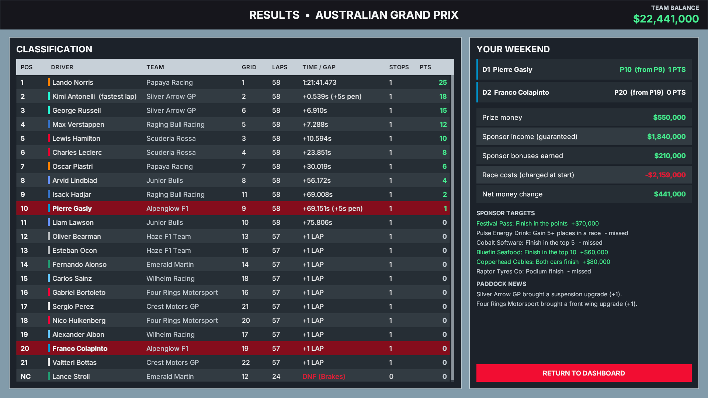

<p align="center">
  
</p>

<h1 align="center">🏁 Formula Team Manager</h1>

<p align="center">
  <b>Run your own 8-bit Formula 1 team.</b><br>
  Sign drivers and sponsors, develop the car, call the strategy from the pit wall<br>
  and race on 22 real circuits, season after season.
</p>

<p align="center">
  <a href="../../releases/latest"><b>⬇️ Download the latest version</b></a>
  &nbsp;•&nbsp; 🪟 Windows &nbsp;•&nbsp; 🍎 macOS &nbsp;•&nbsp; Free
</p>

---

## ⬇️ Download & play

1. Go to **[Releases](../../releases/latest)** and download the zip for your computer:

   | Your computer | Download |
   |---|---|
   | 🪟 **Windows 10 / 11** (64-bit) | `Formula Team Manager (Windows).zip` |
   | 🍎 **Mac** (macOS 12 or newer, Intel or Apple silicon) | `Formula Team Manager (Mac).zip` |

2. **Unzip it**, then start the game:

<details open>
<summary><b>🪟 Windows</b></summary>

- Right-click the zip → **Extract All…**
- Open the **Formula Team Manager** folder and double-click **`Formula Team Manager.exe`**.
- If Windows shows *"Windows protected your PC"*, click **More info → Run anyway**.
  (This appears for any game that isn't from a big publisher; it only happens once.)
- Keep every file in the folder together. The `.exe` needs the files next to it.

</details>

<details>
<summary><b>🍎 Mac</b></summary>

- Double-click the zip to unzip it and drag **Formula Team Manager.app** into **Applications**.
- **First time only:** the game isn't from the App Store, so macOS needs one quick step.
  Open **Terminal** (Applications → Utilities) and paste these lines, pressing Return after each:
  ```
  cd /Applications
  xattr -cr "Formula Team Manager.app"
  chmod +x "Formula Team Manager.app/Contents/MacOS/"*
  codesign --force --deep --sign - "Formula Team Manager.app"
  ```
- Now double-click the app. From then on it opens like any other app.

</details>

No install, no account, no internet needed. Your saves stay on your own computer.

---

## 🎮 What you do

| | |
|---|---|
|  | **Run the team.** Pick one of 11 teams based on the 2026 grid (or build your own), manage your money and keep the sponsors happy. |
|  | **Race weekends.** Practice, Q1–Q3 knockout qualifying and the race on 22 real circuit layouts. Watch every lap or simulate it instantly. |
|  | **Strategy.** Choose starting tyres, follow or override your coordinator's pit plan, and react to rain, safety cars and red flags. |
|  | **Develop.** Upgrade your car during the season, fund next year's car, train your drivers and pit crew. |

## ✨ Features

- 🏎️ **Career mode**: 3 save slots, 11 teams, five difficulty levels from Super Easy to XTREME
- 🗓️ **Full race weekends**: practice, knockout qualifying and the race on 22 real circuits
- 🛞 **Tyres & pit stops**: a fresh allocation every weekend, soft/medium/hard, intermediates and wets, tyre wear (run a tyre to 0% and it bursts), punctures, undercuts, slow stops
- 🌧️ **Race control**: changing weather with forecasts, yellow flags, VSC, safety car, red flags, track limits and penalties
- 📻 **Team radio**: talk to your drivers, change their pace, call them in
- 🧠 **Your call**: let the race coordinator run strategy, or switch it to *suggestions only* and make every call yourself
- 🤝 **Transfer market**: sign drivers, engineers and a race coordinator, or buy out a rival's star
- 💰 **50+ sponsors** with signing bonuses and result bonuses
- 🔁 **Endless careers**: contracts end, drivers age and retire, rookies arrive, rivals develop their cars
- ⏩ **Play at your pace**: 1x / 2x / 3x speed, or simulate a session, the whole weekend or the race in seconds

<p align="center">
  
  
</p>

## ⌨️ Controls

| Key | Does |
|---|---|
| 🖱️ Mouse | Everything |
| `Space` | Pause / resume the race |
| `1` `2` `3` | Race speed 1x / 2x / 3x |
| `Esc` | Close a popup |
| `F11` or `Alt+Enter` (Windows) · `Cmd+F` (Mac) | Full screen / window |

## ❓ Help

- **The game won't start on Windows:** make sure you unzipped it first (don't run it from inside the zip) and kept all the files together.
- **"App is damaged" on Mac:** run the Terminal lines from the Mac section above, then open it again.
- **Where are my saves?** Windows: `%USERPROFILE%\AppData\LocalLow\brucemacowork\Formula Team Manager\Careers`.
- **Found a bug or have an idea?** Open an [Issue](../../issues).

## 🙏 Credits

Made with Unity 6.
Circuit outlines from the MIT-licensed [bacinger/f1-circuits](https://github.com/bacinger/f1-circuits) data.
Fonts: [Inter](https://rsms.me/inter/) and [Press Start 2P](https://fonts.google.com/specimen/Press+Start+2P) (SIL Open Font License).

<sub>Formula Team Manager is an unofficial fan game. It is not affiliated with, endorsed by or connected to Formula 1, the FIA or any team or driver. Team names are made up; driver names are used for fun.</sub>
